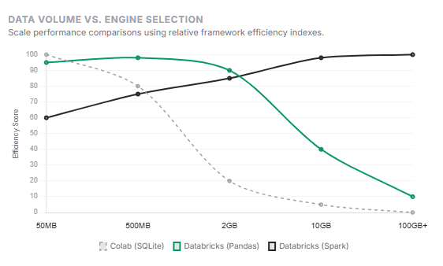

## Comparative Data Engineering: Colab, Pandas, and Spark

This repository compares three ways to implement a healthcare-data ETL and analytics workflow: **Google Colab with SQLite, Databricks with local Python/Pandas, and Databricks with Apache Spark**.

The purpose is to show how the same analytical task can be approached in different execution environments—and how the choice of engine should reflect data size, workload, and operational needs.

## Use case: healthcare staffing data

The workflow processes Payroll-Based Journal (PBJ) staffing hours and aligns them with healthcare facility records. It combines Python-based data preparation with relational operations to produce structured analytical outputs.

The example data domains include:

- **Facility information:** facility identifiers, ratings, bed counts, and locations.
- **PBJ staffing hours:** staffing activity for RN, LPN, and CNA roles.
- **Administrator details:** licensure and contact information used in the matching example.

## Three implementation approaches

| Dimension | Google Colab | Databricks with Pandas | Databricks with Spark |
|---|---|---|---|
| Processing engine | Python and in-memory SQLite | Python and Pandas | Apache Spark / PySpark |
| Execution | Single-node notebook environment | Databricks driver | Distributed Spark environment |
| Typical fit | Prototyping and smaller workloads | Local processing on moderate datasets | Larger workloads suited to distributed processing |
| Main purpose | Interactive development | Lower-overhead tabular processing | Distributed data processing |

The comparison is intended to guide engine selection, not to suggest that one tool is always superior. Actual capacity depends on data shape, memory, cluster configuration, and transformation complexity.

## Shared ETL and analytical steps

Across the implementations, the workflow demonstrates:

1. **Data retrieval:** programmatic access to source CSV files using Python requests and file-like streams.
2. **Header and schema preparation:** dynamic column detection and regular-expression-based cleaning to handle inconsistent source headers.
3. **Identifier standardization:** normalization such as zero-padding CMS identifiers.
4. **Relational processing:** joining staffing, facility, and administrator information.
5. **Analytical output:** aggregating staffing hours and producing facility-level or chain-level views.

The same business problem is implemented through different processing approaches so their trade-offs can be compared.

## Analytical examples

### 1. Chain-level staffing analysis

Aggregates staffing hours to identify healthcare chains with the largest staffing volumes and compare their share of the analysed data.

### 2. Facility and administrator matching

Uses facility identifiers and administrator information to match records and produce a targeted list of facilities for further analysis.

These are demonstrations of data preparation and analytical workflow design, not claims about a live operational healthcare service.

## Automation

The repository includes Databricks and GitHub Actions workflow components for triggering and scheduling the notebook-based process. The notebooks and scripts are organized around the three execution approaches:

- `colab_notebooks.ipynb`
- `databricks_python.py`
- `databricks_spark.ipynb`
- `python.py`

See the repository workflow files for the current automation configuration.

## How to explore

### Google Colab

Open the Colab notebook to review the single-notebook implementation using Python and in-memory SQLite.

### Databricks with Pandas

Import `databricks_python.py` into a Databricks workspace and run the Pandas-based workflow on the driver environment.

### Databricks with Spark

Import `databricks_spark.ipynb` and run the PySpark implementation in a configured Databricks cluster.

The exact runtime and cluster requirements depend on the Databricks environment being used.

## Position within the broader work

This repository focuses on **choosing and implementing an appropriate data-processing approach**. It complements the wider data-engineering and intelligence work:

- [Data Pipelines](https://github.com/panxiaoyan225-sudo/Data-Pipelines): ingestion, validation, database integration, and automation.
- [Data-Driven Foresight](https://github.com/panxiaoyan225-sudo/Data-Driven-Foresight): predictive analysis built on structured historical data.

**The right processing architecture is the one that fits the data, the workload, and the decision that needs to be supported.**

*Note: This repository was developed as a technical assessment demonstrating data engineering and analytical implementation across notebook and distributed-processing environments.*
